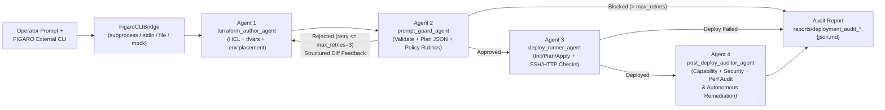

# Quota Pay — Proxmox-First 4-Agent Autonomous Terraform Deployment & Verification Pipeline

## 1. Architecture Overview

Quota Pay's orchestration plane is refactored around a **Proxmox-first (`enable_aws = false` by default, `$0.00/hr`)**, 4-agent LangGraph `StateGraph` supervisor connected directly to **FIGARO's external CLI runtime** via JSON-over-stdin/stdout.



---

## 2. Directory Layout

```text
src/
  orchestrator/
    schema.py                    # Typed PlacementPlan, NodeAllocation (disk_gb, virtualization_type, firewall, ports)
    figaro_cli_bridge.py         # External FIGARO CLI subprocess / stdin / file adapter + Proxmox-first mock
    figaro_adapter.py            # Placement payload normalizer
    figaro_connector.py          # Telemetry collector & multi-transport solver connector
    actuator.py                  # TerraformActuator (load_root_dotenv, export_tfvars_json, plan_json, apply, sync)
  agents/
    state.py                     # Typed AgentState (LangGraph TypedDict) + Pydantic config/audit models
    rubrics.py                   # Pre-deploy policy checks & post-deploy security/capability/perf rubrics
    terraform_author_agent.py    # Agent 1: Prompt + FIGARO directive -> infra/agent_generated.tf & tfvars.json
    prompt_guard_agent.py        # Agent 2: Pre-execution policy, VT-x/KVM guard, secret scan, plan JSON auditor
    deploy_runner_agent.py       # Agent 3: Live/dry-run terraform execution + /healthz, /api/health, latency checks
    post_deploy_auditor_agent.py # Agent 4: Live/staged capability, security & perf audit + autonomous patching
    supervisor.py                # LangGraph StateGraph supervisor & JSON/Markdown audit report generator
infra/
  variables.tf                   # Proxmox-first defaults (`enable_aws = false`, firewall & SSH hardening vars)
  main.tf                        # AWS resources gated behind `var.enable_aws && length(aws_nodes) > 0`
  modules/proxmox_node/          # LXC-first `bpg/proxmox` module + per-node firewall options/rules + SSH hardening
  modules/aws_spot_node/         # Optional secondary AWS Spot module (preserved intact)
scripts/
  run_agent_pipeline.py          # Unified CLI entrypoint (`--prompt`, `--figaro-cmd`, `--figaro-stdin`, `--live`)
  test_agent_pipeline.py         # End-to-end & unit test suite across all 4 agents & FIGARO CLI bridge
reports/
  deployment_audit_<ts>.{json,md}# Timestamped multi-agent execution & remediation audit reports
```

---

## 3. FIGARO External CLI Bridge Contract (`src/orchestrator/figaro_cli_bridge.py`)

### Outbound Request (Streamed on `stdin`, or expanded into `{input_json}`)
```json
{
  "protocol": "quota-figaro-cli/v1",
  "request_id": "figaro-req-a1b2c3d4e5",
  "timestamp": "2026-11-20T16:00:00+00:00",
  "prompt": "Deploy Quota Pay on Proxmox with 4 cores and 2048MB RAM",
  "proxmox_first": true,
  "enable_aws": false,
  "telemetry": { "proxmox_reachable": false, "proxmox_host": "192.168.178.125" },
  "constraints": { "max_hourly_budget_usd": 0.0, "prefer_edge": true, "allow_cloud_burst": false }
}
```

### Inbound Placement Response (From FIGARO `stdout`, piped `stdin`, or `--figaro-file`)
Supports either an `allocations` array or a `nodes` dictionary (even with diagnostic log lines printed before the JSON object):
```json
{
  "scenario": "all_edge",
  "algorithm": "FIGARO-CLI-MILP",
  "allocations": [
    {
      "node_id": "edge-primary",
      "provider": "proxmox",
      "node_name": "pve",
      "cores": 4,
      "memory": 2048,
      "disk_gb": 16,
      "virtualization_type": "lxc",
      "services": ["ingress", "frontend", "ai-proxy"]
    }
  ]
}
```

---

## 4. `AgentState` Contract (`src/agents/state.py`)

| Field Group | Fields | Producer |
| :--- | :--- | :--- |
| **Input** | `run_id`, `prompt`, `figaro_cmd`, `figaro_stdin`, `figaro_file`, `config` | Supervisor |
| **FIGARO Bridge** | `directive`, `figaro_cli_execution` | `FigaroCLIBridge` |
| **Authoring** | `retry_count`, `authored_hcl_path`, `authored_hcl_content`, `tfvars_path`, `tfvars_data`, `placement_env_path` | Agent 1 |
| **Policy Guard** | `guard_approved`, `policy_violations`, `policy_feedback`, `policy_history`, `plan_diff` | Agent 2 |
| **Execution** | `deploy_succeeded`, `terraform_apply_output`, `live_ips`, `functional_checks`, `observed_runtime_telemetry` | Agent 3 |
| **Post-Deploy Audit** | `audit_passed`, `audit_findings`, `remediations_applied`, `post_remediation_findings` | Agent 4 |
| **Audit Output** | `status`, `agent_logs`, `report_json_path`, `report_md_path` | Supervisor |

---

## 5. CLI Usage

```powershell
# 1. Default Proxmox-first dry-run ($0.00/hr, enable_aws=false)
python scripts/run_agent_pipeline.py --prompt "Deploy Quota Pay on Proxmox node pve with 4 cores, 2048MB RAM, and 16GB disk"

# 2. Invoke external FIGARO CLI binary
python scripts/run_agent_pipeline.py --prompt "Optimize placement on Proxmox" --figaro-cmd "figaro-cli solve --json"

# 3. Pipe JSON placement output directly from FIGARO CLI into stdin
cat figaro_plan.json | python scripts/run_agent_pipeline.py --prompt "Apply FIGARO directive" --figaro-stdin

# 4. Live Proxmox execution against existing Container 101
python scripts/run_agent_pipeline.py --prompt "Deploy all-edge on Proxmox" --use-existing-edge --live

# 5. Explicit AWS opt-in (secondary target)
python scripts/run_agent_pipeline.py --prompt "Deploy hybrid Proxmox + AWS Spot" --enable-aws
```
