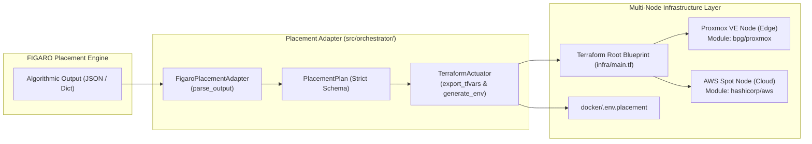

# Quota Pay — Modular Infrastructure Orchestration & Placement Bridge

This document details the decoupled, multi-node infrastructure orchestration architecture designed to place Quota Pay containerized workloads across **Proxmox VE (Edge)** and **AWS Spot (Cloud)**, ready for integration with the upcoming **FIGARO** placement solver.

---

## 1. Architectural Strategy & Decoupled Contract

Because the FIGARO algorithmic engine is being developed independently, a strict, typed contract boundary is established via Python/Pydantic schema definitions in `src/orchestrator/schema.py`:



When FIGARO is connected:
- **Zero Terraform changes required.**
- **Zero Dockerfile or Compose changes required.**
- Only `FigaroPlacementAdapter.parse_output()` consumes the real solver decisions.

---

## 2. Modular Containerization (`docker/`)

Quota Pay is decoupled into three independent components:

| Component | Image / Container | Role | Port | Typical Placement |
|---|---|---|---|---|
| **A: `quota-web-frontend`** | `quota-web-frontend:latest` (Nginx Alpine) | Serves compiled Expo Web SPA static client with gzip/brotli & SPA routing fallback | `8080` | Proxmox VE (Edge) |
| **B: `quota-ai-proxy`** | `quota-ai-proxy:latest` (Node 22 Alpine) | Executes Gemini multimodal receipt OCR parsing & Supabase token ledgering | `3000` | AWS Spot (Cloud) |
| **C: `quota-ingress`** | `caddy:2-alpine` | Reverse proxy terminating SSL/TLS; dynamically routes `/api/*` to AI proxy and `/*` to web frontend | `80`, `443` | Edge / Cloud Gateway |

### Composable Profiles
- **`docker/docker-compose.edge.yml`**: Optimized for Proxmox VE virtualization with local network binds, capped logging (`5m`), and low memory footprints.
- **`docker/docker-compose.cloud.yml`**: Optimized for AWS Spot with FinOps budget limits, ephemeral spot termination handlers, and token ledger synchronization.
- **`docker/.env.placement`**: Injects upstream endpoints dynamically:
  ```ini
  PLACEMENT_SCENARIO=hybrid
  AI_PROXY_UPSTREAM=15.161.41.185:3000
  FRONTEND_UPSTREAM=quota-web-frontend:8080
  DOMAIN_NAME=:80
  ```

---

## 3. Modular Terraform Blueprint (`infra/`)

The infrastructure blueprint is structured into parameter-driven modules:

### Module 1: `infra/modules/proxmox_node`
- **Provider:** `bpg/proxmox` (`>= 0.60.0`)
- **Inputs:** `node_name`, `cores`, `memory_mb`, `disk_gb`, `compose_target`, `services`
- **Mechanism:** Injects cloud-init snippet (`cloud_init.yaml`) that configures Docker and launches `docker compose -f docker/${compose_target} up -d`.

### Module 2: `infra/modules/aws_spot_node`
- **Provider:** `hashicorp/aws` (`~> 5.0`) in `eu-south-1` (Milan)
- **Inputs:** `instance_type`, `subnet_id`, `security_group_id`, `compose_target`, `spot_max_price`, `services`
- **Mechanism:** Injects `user_data.sh` cloud-init bootstrap on Amazon Linux 2023 with ephemeral spot termination handling.

### Root Module (`infra/main.tf`)
Accepts a unified `placement_plan` map and dynamically instantiates instances using `for_each`:

```hcl
variable "placement_plan" {
  type = map(object({
    target_provider = string # "proxmox" or "aws"
    target_node     = optional(string)
    cpu_cores       = number
    memory_mb       = number
    services        = list(string) # e.g. ["quota-ai-proxy"]
  }))
}
```

---

## 4. The Placement Adapter & Orchestrator (`src/orchestrator/`)

- **`schema.py`**: Pydantic v2 data models: `PlacementPlan`, `NodeAllocation`, `ServiceAssignment`, `PlacementDecision`.
- **`figaro_adapter.py`**:
  - `parse_output(raw_figaro_output)`: Normalizes optimizer JSON into `PlacementPlan`.
  - `generate_mock_plan(scenario)`:
    * `all_edge`: Proxmox VE runs all 3 services.
    * `hybrid`: Proxmox VE runs Frontend + Ingress; AWS Spot runs Gemini AI Proxy.
    * `cloud_burst`: AWS Spot runs all 3 services.
- **`actuator.py`**:
  - `export_tfvars_json(plan)`: Serializes plan to `infra/terraform.tfvars.json`.
  - `generate_placement_env(plan)`: Writes `docker/.env.placement`.
  - `init()`, `validate()`, `plan()`, `apply()`: Executes Terraform commands programmatically.

---

## 5. Verification

To verify the placement bridge end-to-end:

```powershell
python scripts/test_placement.py
```

This runs:
1. Pydantic schema validation.
2. FIGARO mock scenario synthesis (`hybrid`, `all_edge`, `cloud_burst`).
3. Raw FIGARO JSON parsing.
4. Automatic serialization to `infra/terraform.tfvars.json`.
5. Dynamic generation of `docker/.env.placement`.
6. Terraform validation (`terraform validate`) and dry-run execution planning (`terraform plan`).
